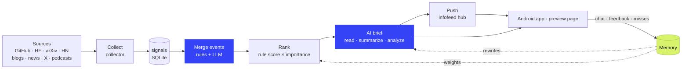

<div align="center">


# Catchup

**Keeps watch on the AI world and pushes you only the changes that matter**

A self-hosted personal AI intelligence assistant: it collects signals from dozens of sources, merges them into events,<br>
reads the originals to write briefs, ranks them by what it remembers about you, and pushes them to your phone.

[](https://github.com/boxpkaka/catchup/releases/latest)
[](https://www.python.org/)
[](pyproject.toml)
[](android/)
[](https://www.deepseek.com/)
[](https://github.com/boxpkaka/catchup/commits/main)
[](LICENSE)

[简体中文](README.md) · **English**

[Features](#-features) · [Sources](#-sources) · [How it works](#-how-it-works) · [Quick start](#-quick-start) · [Self-hosting](#-self-hosting) · [Android app](#-android-app) · [Configuration](#-configuration) · [Development](#-development)

</div>

<br>

> [!NOTE]
> Catchup is built for Chinese readers: briefs, reports and the Android app are in Simplified Chinese, and English source titles are translated into Chinese.

## 💡 Why Catchup

The trouble with scrolling a feed: you read the same story in ten places, the important news is buried in noise, and nobody tells you what happened next. Catchup starts from three different principles:

| | Feed-first | Catchup |
|:--|:--|:--|
| **Push-first** | You scroll, and only know what you happen to see | Important changes are pushed to you; at night only major news gets through, the rest becomes a morning digest |
| **Event-first** | One article at a time, the same story over and over | Reports from many sources about the same thing are merged into one event with one brief |
| **Follow-up-first** | Done once you've read it | Actively follows up and pushes only real progress; questions without an answer yet get answered later |

Tone: Catchup is your personal assistant, like a kind, considerate and dependable butler or secretary who keeps an eye out for you, tidies things up and tells you what matters first. App copy, pushes and everything the model writes to you (chats, reports, memory questions) share this voice: gentle and measured, with opinions but no lecturing, suggestions offered as options, never rushing you or stirring up anxiety. The tone instructions given to the model live in `catchup/tone.py`.

> The full product thesis is in `~/Catchup_for_AI_Product_Thesis.pdf` (a local document on the author's machine, in Chinese).

## ✨ Features

#### 📡 Collect and understand

- **Dozens of sources, each on its own schedule**: code, models, papers, communities, official and research blogs, AI media, expert blogs, podcasts, venture media and rankings. Checked every 10 minutes; each source is collected on its own interval, and failures are retried automatically.
- **Event-first**: rule-based clustering plus DeepSeek decides whether two items are the same story; events are persisted with stable ids.
- **Explainable ranking**: a rule score (interests, source, multiple sources, heat) × the importance the model assigns, with a reason attached to every bonus.
- **AI briefs and analysis**: reads the primary source first, then writes a summary and key points, so you know what happened without opening the link; a separate "AI analysis" covers what is new, the likely impact and the caveats.

#### 🔔 Push and follow up

- **Push-first**: every event judged to be news that hasn't been pushed yet is pushed, with no cap; from 23:00 to 8:00 only major news is pushed, the rest goes into a morning digest.
- **Follow-ups**: searches for later coverage on its own and pushes only real progress.
- **Watched questions**: questions from a chat that had no answer yet are written back into that chat, and pushed, once some report answers them.
- **Daily / weekly / monthly reports**: an "Observations" section first (judgment, evidence, dissenting views, sourced quotes), then key points and per-area lists.

#### 🧠 Learns who you are

- **Memory**: chats, feedback and missed stories settle into six kinds of memory, each with a strength that fades over time and gets tidied up daily; now and then it asks "still following this?".
- **Learns from feedback**: "Not interested" can come with a reason that is recorded on the spot; patterns are only learned once enough deliberate actions add up, and things you merely saw only adjust the strength of existing memories.
- **Memory-driven**: ranking weights and the importance judgment in briefs both draw on memory, and front-page briefs are rewritten when memory changes.

#### 📱 In your pocket

- **Native Android app**: Feed / Topics / Reports pages, gestures that track your finger, cards that expand in place, and memories drawn as bubbles that grow and fade.
- **Chat**: ask about an event (reads the original, cites sources, streams the answer), or ask your own event library directly.
- **Share to Catchup**: share or copy a link; it reads the article, files it under an event and writes a brief.
- **Outage alerts**: when sources keep coming back empty, a small red bar appears at the top of the home page.

<details>
<summary><b>Full feature details</b> (per module)</summary>

<br>

**Collection**

- cron checks every 10 minutes; each source is collected on its own sampling interval (10 minutes to 6 hours), and failed ones are retried after 20 minutes.
- GitHub Trending and the HF trending models list also record each day's rank.
- X without the paid API: takes each day's top posts by engagement from the AINews daily, and reads the post text via the official oEmbed endpoint.

**Events, ranking and briefs**

- Event merging: rule-based clustering + DeepSeek merges reports of the same story; events are persisted with stable ids.
- Ranking: rule score (interests, source, multiple sources, heat) × the importance the model assigns.
- Every event has an AI brief (reads the primary source first, then writes a summary and key points, so you know the gist without opening the link) and an AI analysis (what is new, possible impact, caveats worth noting — kept apart from the facts-only summary).
- English source titles in the app are all translated into Chinese.
- Untracked items: popular stories that seem unrelated to you and stayed off the home page can be corrected with "Show me this kind".

**Push**

- Push whatever can be pushed: events the model judges to be news and that haven't been pushed yet, with no cap; popular news ranked further down is judged too.
- Stories that appear only on rankings such as GitHub Trending, or only in venture media, must be judged "important" by the model before they are pushed or enter the feed; ordinary ones stay in their topic page.
- Swipe right on the home page for "Not interested"; it learns from that feedback.
- From 23:00 to 8:00 only importance-5 major news is pushed; the rest is combined into one morning digest.
- Follow-ups: searches for later coverage and pushes only real progress.
- Delivered through the hub in `../infofeed`.

**Reports**

- One report after each calendar day, week and month ends; weekly and monthly reports are built from the dailies and pushed once when written.
- Each starts with "Observations": it picks a few big stories, gathers HN and Reddit comments, top X posts, analysis from the web and expert blogs from the period, adds who you are and what you've asked lately, and uses deepseek-v4-pro with thinking on to write an opening judgment, several observations (judgment, evidence, dissenting views, quotes), what people think, what it means for you, and what to watch next. Quote sources and links are filled in by code from the material, never invented by the model.
- Key points and per-area lists come after that.

**Chat and sharing**

- Chat: ask under an event (reads the original, cites sources, streams the answer), or ask your own event library.
- Watched questions: questions in a chat that had no answer yet are written back to that chat and pushed once a report answers them.
- Share to Catchup: share from the system sheet or copy a link; it reads the original, files it under an event and writes a brief, and never pushes it back to you.

**Memory**

- Chats, feedback and missed stories settle into six kinds of memory: working on / long-term interest / don't want / preferred sources / unwanted sources / writing style. You can view, edit and delete them, or turn memory off entirely.
- Each memory has a strength: it grows when your behaviour confirms it, and a long-term interest that goes unconfirmed fades (and its ranking weight drops). The same thing phrased differently is not recorded twice; once a day duplicates are merged.
- It asks now and then (a small card at the top of the feed, at most one a day, phrased by the model from the items you skipped): a long-term interest you seem to have dropped gets "still following this?", a "working on" item about to expire gets "still working on this?". Answers take effect immediately.
- Memory-driven: ranking weights and the importance judgment in briefs draw on memory; when memory changes, front-page briefs are rewritten (each round pushes new items first, then rewrites in batches, so pushes are never delayed).

**Learning from feedback**

- When you pick "Not interested" you can choose a reason: the model lists a few kinds of content you might not want and you pick one (recorded as is), or "this source" / "already knew" / "other". A chosen reason is recorded on the spot and deleted if you undo; "other" and reasonless feedback are archived and looked at together for common ground.
- Deliberate actions such as following, asking and rating go into an action log; at most every 6 hours patterns are learned from it (backed by at least two events and enough weight of deliberate actions).
- The app also reports what was shown in the feed and topic pages (more than half visible on a topic page), where a detail page was opened from, how long you stayed and how far you read. These "only seen" signals only strengthen or weaken existing memories and never create new ones.

**Android app**

- The home screen has three pages, "Feed", "Topics" and "Reports"; swipe left for the next page, right for the previous one.
- Feed: newest first by publication time, grouped by day; each day opens with the 3–5 highest-scoring "most worth reading" stories, each on its own coloured card: a cover spans the top and fades into a gradient taken from the cover's colours (like a music app's album-art background), and stories without a cover use their topic's colour and emblem. The colours arrive with the feed, so a card shows its final colour from the start, and images fade in. The rest form a timeline (importance 3 and up get a one-line summary); stories with covers show a thumbnail, topics are plain text without colour, the most important ones are marked "Top story", and scrolling to the end loads older items.
- Topics: topic pages (AI voice / LLMs / Agents / AI venture) collect every event in that topic (including ordinary items that never reached the feed) plus related ranking entries; ranking pages (GitHub Trending / HF trending models / Product Hunt) list every entry by rank, and an HF model opens a model page (Chinese intro, parameter count, precision, licence, base model, with a jump to its event if there is one). Only topic cards have their own colour and badge.
- Reports: swipe between daily / weekly / monthly; scroll to the bottom to continue into the previous issue.
- Gestures and motion: when swiping between ranking categories or report periods, the neighbouring page follows your finger, the tab pill moves with it, and both ends rubber-band. Tapping a story or topic card expands it in place into a full page and closing returns it to its card in the list; other secondary pages slide in from the right and swipe right to go back (with parallax on the page below). Bottom sheets rise from the bottom and pull down to close. Releases carry your finger's velocity; updated content fades in while the rest moves smoothly out of the way.
- The memory page draws memories as bubbles: bigger means stronger, brighter means more recently confirmed, and those about to be forgotten fade and sink. They float up one by one on open, drift gently, show a breathing halo when recently confirmed, and pop when deleted. Tap a bubble to edit or delete it.
- Detail page (summary + key points + AI analysis); "More like this" (a button on the detail page or a double-tap in the feed pops a heart and tells you which memory was added or strengthened); swipe right for "Not interested" (on a followed row, swiping right unfollows and hides the answer); pull to refresh; automatic device binding.
- Outage alerts: if several sources keep returning nothing at the same time (usually the network or proxy is down), a single source gets nothing for 6 hours, or collection stops, a small red bar "Service may be down: …" appears at the top of the home page.

</details>

## 📚 Sources

| Category | Sources |
|:--|:--|
| Code & models | GitHub, GitHub Trending, Hugging Face (including the HF trending models list); new model launches from OpenRouter and from organisations on HF |
| Papers & communities | arXiv, Hacker News, Reddit, YouTube, X (top posts via AINews) |
| Official & news | Official blogs, Google News, Techmeme (tech news), DeepSeek search, page watching |
| Products & venture | Product Hunt (new AI products), TechCrunch Venture, Crunchbase News, The Information, GeekPark (极客公园) |
| Research blogs | Anthropic Research, Microsoft Research, Apple ML |
| AI media | The Decoder, MarkTechPost, MIT Technology Review, The Verge, Ars Technica |
| Chinese media | QbitAI (量子位), InfoQ |
| Expert blogs ★ | Simon Willison, Interconnects, Latent Space, Ahead of AI, One Useful Thing, SemiAnalysis, 宝玉 (Baoyu) |
| Vendor blogs ★ | ElevenLabs, Cursor |
| Podcasts ★ | Lex Fridman, Practical AI, TWIML |

★ Only important stories are pushed. Stories that appear only on rankings or in venture media likewise need the model to judge them "important" before they are pushed. All sources are configured in `config.json` and can be added or removed at any time; to support a new platform, see [Adding a source](#-adding-a-source).

## 🔍 How it works



Data flow: `sources → store(signals) → events(persisted) → ranking(+memory) → brief(LLM) → push / App`; chats, feedback and missed stories in the app → memory → which in turn shapes ranking and briefs.

- **Collection is decoupled from presentation**: changing the ranking doesn't require re-collecting.
- **The URL is the signal's primary key**: each item is stored once, and whether it is new is decided at write time.
- **Rules live in code; the model judges and writes**: clustering, scoring, push rules and the conditions for adding or removing memories are enforced in code, while the model merges stories, assigns importance and writes briefs; quote sources and links in reports are also filled in by code, never invented by the model.

## 🚀 Quick start

**Requirements**

- Python 3.10+; the runtime uses only the standard library, no `pip install` needed
- Optional: `cwebp` (`apt install webp`) to shrink event covers; without it you just get no covers
- A DeepSeek API key for briefs, merging and the DeepSeek source; without one only the rule-based parts run

**Run it**

```bash
git clone https://github.com/boxpkaka/catchup.git
cd catchup
cp .env.example .env                     # fill in DEEPSEEK_API_KEY and other credentials
python3 -m catchup collect --no-update   # collect one round (Reddit is rate-limited; a full round takes about 4 minutes)
python3 -m catchup update --no-push      # merge events and write briefs, without pushing yet
python3 -m catchup serve                 # preview page at http://127.0.0.1:2591
```

> [!TIP]
> In mainland China, Google, Hugging Face, YouTube and Reddit are unreachable without a proxy. Prefix the commands with proxy variables, e.g. for a local mihomo:
> `http_proxy=http://127.0.0.1:7890 https_proxy=http://127.0.0.1:7890 no_proxy=localhost,127.0.0.1`

**Commands**

```bash
python3 -m catchup sources            # list configured sources and available types
python3 -m catchup collect            # collect sources whose interval is due, then merge events, write briefs and push (--no-update: collect only)
python3 -m catchup collect --only youtube reddit   # collect only these sources, ignoring intervals
python3 -m catchup update --no-push   # no collection; re-merge events and write briefs (no push)
python3 -m catchup serve              # preview page at http://127.0.0.1:2591, plus the app API under /v1
python3 -m catchup devices            # list app devices; devices approve <id> approves one, devices mirror <id> approves it as read-only
python3 -m unittest                   # tests
```

**Credentials** (in `.env`, see `.env.example`)

| Variable | Purpose |
|:--|:--|
| `DEEPSEEK_API_KEY` | Briefs, merging and the DeepSeek source; without it only the rule-based parts run |
| `GITHUB_TOKEN` | Optional, raises the GitHub API rate limit |
| `FEED_URL` / `FEED_TOKEN` | Pushing to the hub |
| `SHARE_KEY` | Optional share key: a new device that enters it on the pending page becomes a read-only device right away |
| `APK_KEYSTORE_PASS` | Only for building the app: the signing keystore password |

## 🏠 Self-hosting

This is how it runs on the author's server:

| Component | Role |
|:--|:--|
| `catchup collect` (cron, every 10 minutes) | Collects due sources, then merges events, writes briefs and pushes |
| `catchup serve` (systemd user service `catchup-web`) | Preview page and app API `/v1`, listening only on `127.0.0.1:2591` |
| The hub in `../infofeed` | Push channel (`/stream` needs no auth, `/publish` needs `FEED_TOKEN`) and app distribution (`/app/version`, `/app.apk`) |
| Caddy | Public entry point `https://43.139.27.91:8443`, with a certificate from its internal CA |

**Long-running service**

`catchup serve` runs as the systemd user service `catchup-web`; restart it after changing code:

```bash
systemctl --user restart catchup-web
```

**Scheduled collection**

Google, Hugging Face, YouTube and Reddit can't be reached directly from the server, so collection goes through the local mihomo proxy, and mihomo rules send domestic sites direct; the `catchup-web` systemd unit sets the same `Environment=`:

```cron
*/10 * * * * cd /home/boxp/workspace/catchup && http_proxy=http://127.0.0.1:7890 https_proxy=http://127.0.0.1:7890 no_proxy=localhost,127.0.0.1 /usr/bin/python3 -m catchup collect >> logs/collect.log 2>&1
```

**Devices**

- The app reaches `https://43.139.27.91:8443/v1/*` through Caddy; the first device to register is approved automatically, and later ones must be confirmed with `devices approve <id>`.
- To share with someone else, approve their device as read-only with `devices mirror <id>`: they see exactly what you see (pushes included), but feedback, follows, chat and memory edits are rejected, so your recommendations are unaffected.
- With `SHARE_KEY` set, a new device that enters the key on the pending page becomes a read-only device without waiting for approval.

**Viewing the preview page remotely**

The preview page only listens on localhost; use SSH port forwarding:

```bash
ssh -L 2591:127.0.0.1:2591 <server>
```

## 📱 Android app

Written in plain Java against the Android SDK only, supporting Android 10 (API 29) and up. The app is called Catchup, while the package name stays `cloud.boxpkaka.infofeed` so existing installs can upgrade in place.

**Install and update**

- First install: open `https://43.139.27.91:8443/app.apk` in the phone's browser (it will warn that the certificate isn't trusted; choose to continue).
- Works right after opening, no token needed.
- The app checks for updates on every launch and pull-to-refresh; when the version is newer it shows "New version … ready", and tapping it downloads the APK and opens the system installer. You can also "Check for updates" manually in settings.
- GitHub is unreliable from phones on networks in mainland China, so the app only talks to the same server used for push: `../infofeed/hub.py` serves `/app/version` and `/app.apk` from `android/dist/`. [GitHub Releases](https://github.com/boxpkaka/catchup/releases) are an archive only.

**Build and release**

No Gradle: `android/build.sh` packages the app by calling the SDK tools directly (JDK 17 in `~/.local/share/jdk17`, SDK in `~/.local/share/android-sdk`).

```bash
./android/build.sh                  # local debug build → android/build/infofeed.apk (version 0.0.0-dev)
./android/release.sh 1.1.0          # build v1.1.0: put it in android/dist/ for the self-hosted server and publish a GitHub Release as an archive
```

Commit and `git push` before releasing; the script checks.

> [!WARNING]
> Signing uses the local `android/release.keystore` (not in the repo), whose password is `APK_KEYSTORE_PASS` in `.env`. If the key changes, installed apps can no longer upgrade in place.

**Network and certificates**

- The app connects to the IP directly at `https://43.139.27.91:8443`: `boxpkaka.cloud` has no ICP filing, so Tencent Cloud resets ordinary TLS connections on 443.
- The 8443 certificate is issued by Caddy's internal CA on the server; through `res/xml/network_security_config.xml`, the app trusts only the bundled `res/raw/catchup_ca.crt`, and only for that IP.

**Icon**

The adaptive icon in `res/mipmap-anydpi-v26/`: a cobalt background, a bold white "c", and a lime dot in its gap. The same shape is used for the themed icon and the notification icon.

## 🔧 Configuration

Each key under `sources` in `config.json` is a source instance; `type` selects the plugin, and the remaining fields are that plugin's parameters. Common fields:

| Field | Meaning |
|:--|:--|
| `type` | Plugin type; `python3 -m catchup sources` lists them all |
| `title` | Source name shown on pages |
| `tier` | `official` (first-party official source) / `primary` (first-hand technical source) / `signal` (weak signal); affects ranking |
| `kind` | Content category, e.g. 代码 (code), 模型 (models), 论文 (papers), 社区 (community), 视频 (video), 新闻 (news) |
| `interval` | Sampling interval in minutes (default 60). cron runs every 10 minutes, so use multiples of 10; a source is collected once the interval has passed since its last run |
| `enabled` | Set to `false` to disable temporarily |
| `important_only` | Push only important stories: events coming only from this source must be judged "important" by the model (`board_min_importance` under `push`, default 4) to be pushed and enter the feed; ordinary ones stay in their topic page. On by default for ranking sources; for other sources (such as the venture media `venture`), turning it on means every story gets a brief and a main topic regardless of rank |

`interests` is the interest profile (name, weight, keywords); each interest is also a topic page (the model picks each story's main topic from these). `ranking` holds the ranking parameters (time window, half-life, tier weights and so on; defaults are in `DEFAULTS` in `pipeline/ranking.py`).

## 📂 Project layout

```
catchup/
  models.py          Signal (one raw item), Event (one merged story)
  sources/           Source plugins: base.py defines the base class and registry, one class per source type
  store.py           SQLite storage with sequential migrations (PRAGMA user_version)
  collector.py       Runs sources in turn; one failing source doesn't affect the others; flags likely outages from collection records
  llm.py             DeepSeek chat client (deepseek-flash, thinking off; JSON and streaming output)
  personal.py        Personal memory: extraction, feedback learning, missed stories, the memory-aware ranker and "who the reader is"
  chat.py            Chat: answers from the original ([1] citations) or from the event library ([E12] citations); extracts memories and watched questions after each turn
  share.py           Shared links: read the original, file it under an event, write a brief
  reader.py          Reads originals: ordinary pages via DeepSeek fetch; Google News redirects, Reddit posts and HF model pages handled separately
  images.py          Event covers (og:image shrunk to 720px WebP) and site icons, fetched from the original site on the app's behalf and stored in data/images
  pipeline/
    events.py        Signals → events: rule-based clustering, persisted as events with stable ids
    ranking.py       Event scoring, with an explainable reason for every bonus
    brief.py         Model merges reports of the same story and reads originals to write briefs (title / summary / key points / AI analysis / importance); lower-ranked new reports are pre-screened by title first
    push.py          Picks events to push and delivers them via the hub; builds the morning digest; pushes follow-up progress
    follow.py        Follow-ups: searches for later coverage and judges whether there is real progress
    answers.py       Watched questions: looks for answers in new reports and writes them back to the chat
    intros.py        HF models known only by name: reads the model card and writes a one-line Chinese intro, shown in rankings and on events without a brief
    translate.py     Translates English text that appears in the app (source titles, summaries without a brief) into Chinese and caches it
    reports.py       Daily, weekly and monthly reports: written once the period ends; weekly and monthly reports are pushed when written
    voices.py        Commentary for reports: HN / Reddit comments, top X posts, analysis found by web search, expert blogs
    update.py        The whole post-collection pipeline
    feed.py          Data for the preview page
  web/
    server.py        Preview page + app API routes
    app_api.py       App API: device binding, feed (paged by publication time), reports, details, feedback, chat, memory, follows
android/             Android app (plain Java; build.sh / release.sh build and release it)
tests/               unittest tests
config.json          Sources, interests, ranking parameters
data/catchup.db      Database (not in the repo)
```

## 🧩 Adding a source

1. Create a module under `catchup/sources/` that subclasses `Source` (feed-based sources subclass `FeedSource` and only implement `feeds()`):

   ```python
   @register
   class Bluesky(Source):
       type = "bluesky"
       default_kind = "社区"
       label_format = "Bluesky · {channel}"

       def fetch(self):
           for handle in self.options["accounts"]:
               ...
               yield self.signal(url, title, summary, channel=handle, published=parse_time(ts), heat=likes / 100)
   ```

2. Import the module in `catchup/sources/__init__.py`.
3. Add a `{"type": "bluesky", ...}` instance under `sources` in `config.json`.
4. Write parsing tests in `tests/`, replacing `catchup.http.get` / `get_json` with `unittest.mock`.

**Conventions**

- The URL is the dedup key, so normalise it as much as possible (e.g. drop the arXiv version, prefer the external link for HN).
- Each source normalises its own `heat`; about 1 means clearly popular.
- Log failed sub-requests with `log.warning` and carry on.
- Ranking sources (GitHub Trending, HF trending models) set `board = True` and return items in rank order from `fetch()`: the signals table records only the first appearance of a URL, while each board's current ranks and when the current run on the board began are kept in the `board_items` table (`Store.update_board` / `Store.board`).

## 🧪 Development

```bash
python3 -m unittest
```

- **Zero runtime dependencies**: standard library only; tests use `unittest`, no pytest / requests.
- **Database migrations**: only append to the end of `MIGRATIONS` in `store.py`; never modify existing entries.
- **Time**: always stored as UTC ISO strings (`util.to_iso`).
- More pitfalls (network proxy, the memory loop, which network calls to mock in tests, and so on) are documented in [`CLAUDE.md`](CLAUDE.md) (in Chinese).

## 🧭 Roadmap

- [x] Multi-source signal collection, each source on its own interval with retries
- [x] Event merging, explainable ranking, AI briefs and analysis
- [x] Push, major-news-only at night, morning digest
- [x] Native Android app with in-app updates
- [x] Chat, memory and learning from feedback
- [x] Follow-ups and watched questions
- [x] Daily / weekly / monthly reports
- [x] Share to Catchup, untracked items, outage alerts
- [ ] New sources: Xiaohongshu / Chinese podcasts

## 🙏 Acknowledgements

- Thanks to every source listed above; Catchup just reads them for you.
- The app uses the [Roboto Flex](https://github.com/googlefonts/roboto-flex) font (SIL Open Font License 1.1, see `android/OFL-roboto-flex.txt`).

## 📄 License

[MIT](LICENSE). The Roboto Flex font bundled in the app remains under the SIL Open Font License 1.1.

<br>

<div align="center">
<sub>The lime dot in the icon's gap: whatever you missed, filled in for you.</sub>
</div>
