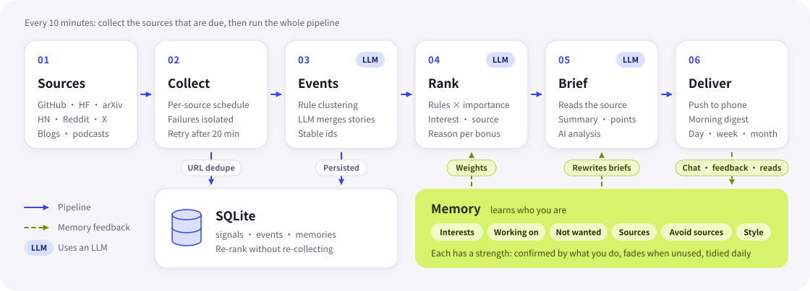

<div align="center">


# Catchup

**Keeps watch on the AI world and pushes you only the changes that matter**

A self-hosted personal AI intelligence assistant: it collects signals from dozens of sources, merges them into events,<br>
reads the originals to write briefs, ranks them by what it remembers about you, and pushes them to your phone.

[](https://github.com/boxpkaka/catchup/releases/latest)
[](https://www.python.org/)
[](pyproject.toml)
[](android/)
[](https://www.deepseek.com/)
[](https://github.com/boxpkaka/catchup/commits/main)
[](LICENSE)

[简体中文](README.md) · **English**

[Features](#-features) · [Sources](#-sources) · [How it works](#-how-it-works) · [Quick start](#-quick-start) · [Docs](#-docs)

</div>

<br>

> [!NOTE]
> Catchup is built for Chinese readers: briefs, reports and the Android app are in Simplified Chinese, and English source titles are translated into Chinese.

## 💡 Why Catchup

**Stop checking. You won't miss it.** The trouble with scrolling a feed: you read the same story in ten places, the important news is buried in noise, and nobody tells you what happened next. Catchup starts from three different principles:

| | Feed-first | Catchup |
|:--|:--|:--|
| **Push-first** | You scroll, and only know what you happen to see | Important changes are pushed to you; at night only major news gets through, the rest becomes a morning digest |
| **Event-first** | One article at a time, the same story over and over | Reports from many sources about the same thing are merged into one event with one brief |
| **Follow-up-first** | Done once you've read it | Actively follows up and pushes only real progress; questions without an answer yet get answered later |

> The full product thesis (the problem, why AI first, how to tell it works) is in [docs/product.md](docs/product.md) (in Chinese).

## ✨ Features

#### 📡 Collect and understand

- **Dozens of sources, each on its own schedule**: code, models, papers, communities, official and research blogs, AI media, expert blogs, podcasts, venture media and rankings. Checked every 10 minutes; each source is collected on its own interval, and failures are retried automatically.
- **Event-first**: rule-based clustering plus DeepSeek decides whether two items are the same story; events are persisted with stable ids.
- **Explainable ranking**: a rule score (interests, source, multiple sources, heat) × the importance the model assigns, with a reason attached to every bonus.
- **AI briefs and analysis**: reads the primary source first, then writes a summary and key points, so you know what happened without opening the link; a separate "AI analysis" covers what is new, the likely impact and the caveats.

#### 🔔 Push and follow up

- **Push-first**: every event judged to be news that hasn't been pushed yet is pushed, with no cap; from 23:00 to 8:00 only major news is pushed, the rest goes into a morning digest.
- **Follow-ups**: searches for later coverage on its own and pushes only real progress.
- **Watched questions**: questions from a chat that had no answer yet are written back into that chat, and pushed, once some report answers them.
- **Daily / weekly / monthly reports**: an "Observations" section first (judgment, evidence, dissenting views, sourced quotes), then key points and per-area lists.

#### 🧠 Learns who you are

- **Memory**: chats, feedback and missed stories settle into six kinds of memory, each with a strength that fades over time and gets tidied up daily; now and then it asks "still following this?".
- **Learns from feedback**: "Not interested" can come with a reason that is recorded on the spot; patterns are only learned once enough deliberate actions add up, and things you merely saw only adjust the strength of existing memories.
- **Memory-driven**: ranking weights and the importance judgment in briefs both draw on memory, and front-page briefs are rewritten when memory changes.

#### 📱 In your pocket

- **Native Android app**: Feed / Topics / Reports pages, gestures that track your finger, cards that expand in place, and memories drawn as bubbles that grow and fade.
- **Chat**: ask about an event (reads the original, cites sources, streams the answer), or ask your own event library directly; on a paper it reads the full text and walks you through it like a peer.
- **Papers**: every new paper is checked against your memory with a one-line reason why it matters to you; arXiv is searched by your memory, and papers worth reading get a brief.
- **Share to Catchup**: share or copy a link; it reads the article, files it under an event and writes a brief.
- **Outage alerts**: when sources keep coming back empty, a small red bar appears at the top of the home page.

Full details: [Features](docs/features.md) (in Chinese).

## 📚 Sources

| Category | Sources |
|:--|:--|
| Code & models | GitHub, GitHub Trending, Hugging Face (including the HF trending models list); new model launches from OpenRouter and from organisations on HF |
| Papers & communities | arXiv, Hacker News, Reddit, YouTube, X (top posts via AINews) |
| Official & news | Official blogs, Google News, Techmeme (tech news), DeepSeek search, page watching |
| Products & venture | Product Hunt (new AI products), TechCrunch Venture, Crunchbase News, The Information, GeekPark (极客公园) |
| Research blogs | Anthropic Research, Microsoft Research, Apple ML |
| AI media | The Decoder, MarkTechPost, MIT Technology Review, The Verge, Ars Technica |
| Chinese media | QbitAI (量子位), InfoQ |
| Expert blogs ★ | Simon Willison, Interconnects, Latent Space, Ahead of AI, One Useful Thing, SemiAnalysis, 宝玉 (Baoyu) |
| Vendor blogs ★ | ElevenLabs, Cursor |
| Podcasts ★ | Lex Fridman, Practical AI, TWIML |

★ Only important stories are pushed. Stories that appear only on rankings or in venture media likewise need the model to judge them "important" before they are pushed. All sources are configured in `config.json` and can be added or removed at any time; to support a new platform, see [Development](docs/development.md#新增一种来源) (in Chinese).

## 🔍 How it works

<p align="center"></p>

- **Collection is decoupled from presentation**: changing the ranking doesn't require re-collecting.
- **The URL is the signal's primary key**: each item is stored once, and whether it is new is decided at write time.
- **Rules live in code; the model judges and writes**: clustering, scoring, push rules and the conditions for adding or removing memories are enforced in code, while the model merges stories, assigns importance and writes briefs; quote sources and links in reports are also filled in by code, never invented by the model.

Data flow, design trade-offs and the project layout: [How it works](docs/architecture.md) (in Chinese).

## 🚀 Quick start

**Requirements**

- Python 3.10+; the runtime uses only the standard library, no `pip install` needed
- Optional: `cwebp` (`apt install webp`) to shrink event covers; without it you just get no covers
- A DeepSeek API key for briefs, merging and the DeepSeek source; without one only the rule-based parts run

**Run it**

```bash
git clone https://github.com/boxpkaka/catchup.git
cd catchup
cp .env.example .env                     # fill in DEEPSEEK_API_KEY and other credentials
python3 -m catchup collect --no-update   # collect one round (Reddit is rate-limited; a full round takes about 4 minutes)
python3 -m catchup update --no-push      # merge events and write briefs, without pushing yet
python3 -m catchup serve                 # preview page at http://127.0.0.1:2591
```

> [!TIP]
> In mainland China, Google, Hugging Face, YouTube and Reddit are unreachable without a proxy. Prefix the commands with proxy variables, e.g. for a local mihomo:
> `http_proxy=http://127.0.0.1:7890 https_proxy=http://127.0.0.1:7890 no_proxy=localhost,127.0.0.1`

**Commands**

```bash
python3 -m catchup sources            # list configured sources and available types
python3 -m catchup collect            # collect sources whose interval is due, then merge events, write briefs and push (--no-update: collect only)
python3 -m catchup collect --only youtube reddit   # collect only these sources, ignoring intervals
python3 -m catchup update --no-push   # no collection; re-merge events and write briefs (no push)
python3 -m catchup serve              # preview page at http://127.0.0.1:2591, plus the app API under /v1
python3 -m catchup devices            # list app devices; devices approve <id> approves one, devices mirror <id> approves it as read-only
python3 -m unittest                   # tests
```

Credentials go in `.env` (see `.env.example`); at minimum set `DEEPSEEK_API_KEY`. What each one does, and the `config.json` parameters, are in [Configuration](docs/configuration.md) (in Chinese).

## 📖 Docs

The detailed docs are in Chinese.

| Doc | Contents |
|:--|:--|
| [Product thesis](docs/product.md) | The problem, why AI first, how to tell it works |
| [Features](docs/features.md) | Full details of collection, push, reports, chat, memory, feedback learning and the app |
| [How it works](docs/architecture.md) | Architecture diagram, data flow, design trade-offs and project layout |
| [Configuration](docs/configuration.md) | Sources, interests and ranking parameters in `config.json`, plus `.env` credentials |
| [Self-hosting](docs/deployment.md) | Server components, long-running service, scheduled collection, device management |
| [Android app](docs/android.md) | Install and update, build and release, network and certificates |
| [Voice and design](docs/design.md) | Tone, colors, type, icon and motion |
| [Development](docs/development.md) | Tests, conventions and adding a new source |

## 🧭 Roadmap

- [x] Multi-source signal collection, each source on its own interval with retries
- [x] Event merging, explainable ranking, AI briefs and analysis
- [x] Push, major-news-only at night, morning digest
- [x] Native Android app with in-app updates
- [x] Chat, memory and learning from feedback
- [x] Follow-ups and watched questions
- [x] Daily / weekly / monthly reports
- [x] Share to Catchup, untracked items, outage alerts
- [ ] New sources: Xiaohongshu / Chinese podcasts

## 🙏 Acknowledgements

- Thanks to every source listed above; Catchup just reads them for you.
- The app uses the [Roboto Flex](https://github.com/googlefonts/roboto-flex) font (SIL Open Font License 1.1, see `android/OFL-roboto-flex.txt`).

## 📄 License

[MIT](LICENSE). The Roboto Flex font bundled in the app remains under the SIL Open Font License 1.1.

<br>

<div align="center">
<sub>The lime dot in the icon's gap: whatever you missed, filled in for you.</sub>
</div>
