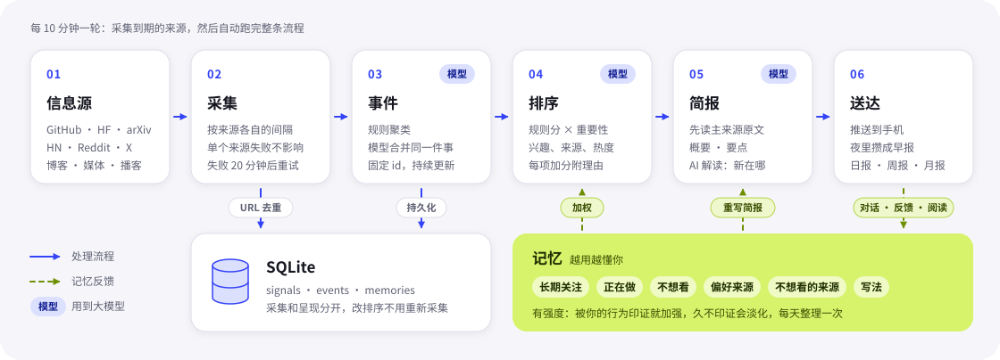

<div align="center">


# Catchup

**替你持续盯住 AI 领域，只把真正重要的变化推给你**

自托管的个人 AI 情报助手：从几十个信息源采集信号，合并成事件，<br>
读原文写好简报，按你的记忆排序，再推到你的手机上。

[](https://github.com/boxpkaka/catchup/releases/latest)
[](https://www.python.org/)
[](pyproject.toml)
[](android/)
[](https://www.deepseek.com/)
[](https://github.com/boxpkaka/catchup/commits/main)
[](LICENSE)

**简体中文** · [English](README.en.md)

[功能](#-功能) · [信息源](#-信息源) · [工作原理](#-工作原理) · [快速开始](#-快速开始) · [文档](#-文档)

</div>

<br>

## 💡 为什么是 Catchup

**不用刷，重要的不会错过。** 刷信息流的问题是：同一件事在十个地方各看一遍，重要的消息混在噪音里，看完之后的进展也没人告诉你。Catchup 换了三个出发点：

| | Feed-first 信息流 | Catchup |
|:--|:--|:--|
| **Push-first** | 你去刷，刷到才算知道 | 重要的变化主动推给你；夜里只推重大消息，其余早上合成一条早报 |
| **Event-first** | 一条条文章，同一件事反复出现 | 多个来源说的同一件事合并成一个事件，一份简报讲清楚 |
| **Follow-up-first** | 读完即止 | 主动追踪后续、只推实质进展；暂时没答案的问题，之后替你找到回答 |


> 完整的产品思路（要解决什么问题、为什么先做 AI、怎么判断做对了）见 [产品思路](docs/product.md)。

## ✨ 功能

#### 📡 采集与理解

- **数十个来源，各按各的节奏**：代码、模型、论文、社区、官方与研究博客、AI 媒体、专家博客、播客、创投媒体和各类榜单，每 10 分钟检查一次，各来源按自己的采样间隔采集，失败的自动重试。
- **事件优先**：规则聚类 + DeepSeek 判断是不是同一件事，事件持久化、有固定 id。
- **可解释的排序**：规则分（兴趣、来源、多源、热度）× 模型给的重要性，每项加分都附带理由。
- **AI 简报与解读**：先读主来源原文，写概要和要点，不点链接也知道主要内容；“AI 解读”单独讲新在哪、可能的影响和值得留意的局限。

#### 🔔 推送与跟进

- **推送优先**：判定为新闻、还没推过的事件都推，不限条数；23:00～8:00 只推重大消息，其余合成早报。
- **持续追踪**：主动搜后续报道，只推实质进展。
- **替你留意**：对话里暂时没答案的问题，之后有报道回答了就写回原对话并推送。
- **日报 / 周报 / 月报**：先写“观察”（判断、依据、不同看法、有出处的引语），再列要点和分领域清单。

#### 🧠 越用越懂你

- **记忆**：对话、反馈、漏报沉淀为六类记忆，有强度、会淡化、每天整理，偶尔还会主动问一句“还关注吗”。
- **从反馈里学**：“不需要”可以选原因并当场记下；主动行为攒够了再归纳规律，“只是看过”的只调整已有记忆的强度。
- **记忆驱动**：排序加权和简报的重要性判断都参考记忆，记忆变了就重写前排简报。

#### 📱 随身可用

- **原生安卓 App**：信息流 / 专题 / 报告三页，手势跟手，卡片原地展开，记忆画成会长大、淡去的气泡。
- **对话**：在事件下提问（先读原文、标注出处、流式输出），或直接问自己的事件库。
- **分享到 Catchup**：系统分享或复制链接，读原文、归入事件、写简报。
- **故障提示**：来源连续采不到内容时，首页顶部出一条小红条。

完整细节见 [功能说明](docs/features.md)。

## 📚 信息源

| 类别 | 来源 |
|:--|:--|
| 代码与模型 | GitHub、GitHub Trending、Hugging Face（含 HF 模型热榜）；新模型上架看 OpenRouter 和 HF 各家机构 |
| 论文与社区 | arXiv、Hacker News、Reddit、YouTube、X（AINews 的热帖） |
| 官方与新闻 | 官方博客、Google News、Techmeme（科技快讯）、DeepSeek 搜索、页面监控 |
| 新产品与创投 | Product Hunt（AI 新产品）、TechCrunch Venture、Crunchbase News、The Information、极客公园 |
| 研究博客 | Anthropic Research、Microsoft Research、Apple ML |
| AI 媒体 | The Decoder、MarkTechPost、MIT Technology Review、The Verge、Ars Technica |
| 中文媒体 | 量子位、InfoQ |
| 专家博客 ★ | Simon Willison、Interconnects、Latent Space、Ahead of AI、One Useful Thing、SemiAnalysis、宝玉 |
| 厂商博客 ★ | ElevenLabs、Cursor |
| 播客 ★ | Lex Fridman、Practical AI、TWIML |

★ 只推重要的；只出现在榜单或创投媒体上的事件，同样要模型判为“重要”才推送。来源都在 `config.json` 里配置，可以随时增删；想接入新的平台见[新增一种来源](docs/development.md#新增一种来源)。

## 🔍 工作原理

<p align="center"></p>

- **采集和呈现解耦**：改排序不需要重新采集。
- **URL 是信号主键**：同一条内容只记一次，新内容靠写入时判断。
- **规则在代码里，模型负责判断和写作**：聚类、打分、推送和记忆增删的条件由代码把关，模型负责合并同一件事、给重要性和写简报；报告引语的出处和链接也由代码填，不让模型编。

数据流、设计取舍和项目结构见 [工作原理](docs/architecture.md)。

## 🚀 快速开始

**环境要求**

- Python 3.10+，运行时只依赖标准库，不需要 `pip install`
- 可选：`cwebp`（`apt install webp`），用于事件封面缩图；没装时只是没有封面
- DeepSeek API Key：简报、合并和 DeepSeek 来源要用；没有则只跑规则部分

**跑起来**

```bash
git clone https://github.com/boxpkaka/catchup.git
cd catchup
cp .env.example .env                     # 填入 DEEPSEEK_API_KEY 等凭据
python3 -m catchup collect --no-update   # 采集一轮（Reddit 限流严，完整一轮约 4 分钟）
python3 -m catchup update --no-push      # 归并事件、写简报，先不推送
python3 -m catchup serve                 # 预览页 http://127.0.0.1:2591
```

> [!TIP]
> 在国内网络下，Google、Hugging Face、YouTube、Reddit 直连不通，需要给命令加上代理，例如本机 mihomo：
> `http_proxy=http://127.0.0.1:7890 https_proxy=http://127.0.0.1:7890 no_proxy=localhost,127.0.0.1`

**命令一览**

```bash
python3 -m catchup sources            # 列出已配置的来源和可用类型
python3 -m catchup collect            # 采集到了采样间隔的来源，之后自动做事件归并、简报和推送（--no-update 只采集）
python3 -m catchup collect --only youtube reddit   # 只采指定来源，不看采样间隔
python3 -m catchup update --no-push   # 不采集，只重新归并事件、写简报（不推送）
python3 -m catchup serve              # 预览页 http://127.0.0.1:2591，以及 App 接口 /v1
python3 -m catchup devices            # 查看 App 设备；devices approve <id> 批准新设备，devices mirror <id> 批准为只读
python3 -m unittest                   # 测试
```

凭据放在 `.env`（参考 `.env.example`），至少填 `DEEPSEEK_API_KEY`；各项含义和 `config.json` 的参数见 [配置](docs/configuration.md)。

## 📖 文档

| 文档 | 内容 |
|:--|:--|
| [产品思路](docs/product.md) | 要解决什么问题、为什么先做 AI、怎么判断做对了 |
| [功能说明](docs/features.md) | 采集、推送、报告、对话、记忆、反馈学习和 App 的完整细节 |
| [工作原理](docs/architecture.md) | 架构图、数据流、设计取舍和项目结构 |
| [配置](docs/configuration.md) | `config.json` 里的来源、兴趣、排序参数，以及 `.env` 凭据 |
| [自托管部署](docs/deployment.md) | 服务器上的组件、常驻服务、定时采集、设备管理 |
| [安卓 App](docs/android.md) | 安装与更新、构建与发布、网络与证书 |
| [文案与设计](docs/design.md) | 调性、颜色、字体、图标和动效 |
| [开发](docs/development.md) | 测试、开发约定和新增一种来源 |

## 🧭 路线图

- [x] 多源信号采集，各来源按自己的采样间隔采集、失败重试
- [x] 事件合并、可解释排序、AI 简报与解读
- [x] 推送、夜间只推重大消息、早报
- [x] 原生安卓 App 与应用内更新
- [x] 对话、记忆与反馈学习
- [x] 持续追踪、替你留意的问题
- [x] 日报 / 周报 / 月报
- [x] 分享到 Catchup、未追踪信息、故障提示
- [ ] 新来源：小红书 / 中文播客

## 🙏 致谢

- 感谢上面列出的每一个信息源，Catchup 只是替你读它们。
- App 字体使用 [Roboto Flex](https://github.com/googlefonts/roboto-flex)（SIL Open Font License 1.1，见 `android/OFL-roboto-flex.txt`）。

## 📄 许可证

[MIT](LICENSE)。App 内置的 Roboto Flex 字体仍按 SIL Open Font License 1.1 授权。

<br>

<div align="center">
<sub>图标缺口处那颗酸橙色的点：没跟上的，替你补上。</sub>
</div>
