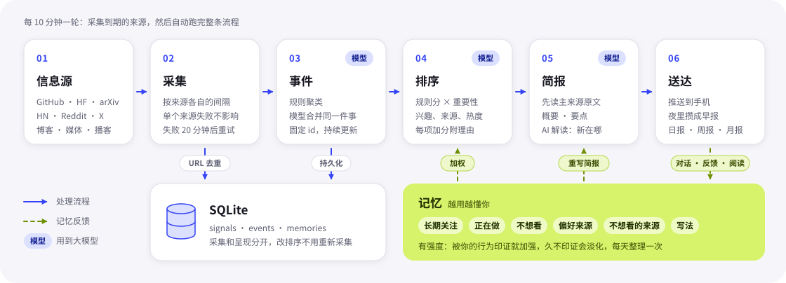

# 工作原理

[← 返回文档目录](../README.md#-文档)

<p align="center"></p>

## 数据流

数据流：`sources → store(signals) → events(持久化) → ranking(+记忆) → brief(LLM) → push / App`；App 里的对话、反馈、漏报 → 记忆 → 反过来影响 ranking 和 brief。

## 设计取舍

- **采集和呈现解耦**：改排序不需要重新采集。
- **URL 是信号主键**：同一条内容只记一次，新内容靠写入时判断。
- **规则在代码里，模型负责判断和写作**：聚类、打分、推送和记忆增删的条件由代码把关，模型负责合并同一件事、给重要性和写简报；报告引语的出处和链接也由代码填，不让模型编。

## 项目结构

```
catchup/
  models.py          Signal（一条原始内容）、Event（合并后的一件事）
  sources/           来源插件：base.py 定义基类和注册表，每种来源一个类
  store.py           SQLite 存储与顺序迁移（PRAGMA user_version）
  collector.py       依次运行来源，单个来源失败不影响其他来源；按采集记录判断是否疑似故障
  llm.py             DeepSeek 对话接口（deepseek-flash，关闭思考；JSON 输出和流式输出）
  personal.py        个人记忆：提取、反馈学习、漏报、构建带记忆的排序器和“读者是谁”
  chat.py            对话：读原文回答（标注 [1]）或问事件库（标注 [E12]），每轮后提取记忆和待留意的问题
  share.py           分享进来的链接：读原文、归入事件、写简报
  reader.py          读原文：一般网页走 DeepSeek fetch，Google News 跳转链接、Reddit 帖子、HF 模型页另行处理
  images.py          事件封面（og:image 缩成 720px WebP）和网站图标：替 App 去原网站取，存在 data/images
  pipeline/
    events.py        信号 → 事件：规则聚类，并持久化为有固定 id 的事件
    ranking.py       事件打分，每项加分都附带可解释的理由
    brief.py         模型合并同一件事、读原文写简报（标题 / 概要 / 要点 / AI 解读 / 重要性），排名靠后的新报道先按标题初筛
    push.py          选择要推送的事件并经 hub 送达；早上合成早报；追踪进展推送
    follow.py        追踪：主动搜后续报道，判断是否有实质进展
    answers.py       替你留意的问题：在新报道里找答案，写回原对话
    intros.py        只有名字的 HF 模型：读模型卡写一句中文简介，榜单和没写简报的事件都显示它
    translate.py     把 App 上会出现的英文原文（来源标题、没写简报的摘要）翻成中文并缓存
    reports.py       日报、周报、月报：时间段结束后写好，周报月报写好后推送
    voices.py        报告的评论材料：HN / Reddit 评论、X 热帖、联网搜索的分析、专家博客
    update.py        采集之后的整条处理流程
    feed.py          预览页用的数据
  web/
    server.py        预览页 + App 接口路由
    app_api.py       App 接口：设备绑定、信息流（按见报时间翻页）、报告、详情、反馈、对话、记忆、追踪
android/             安卓 App（原生 Java，build.sh / release.sh 打包发布）
tests/               unittest 测试
config.json          来源、兴趣、排序参数
data/catchup.db      数据库（不入库）
```
